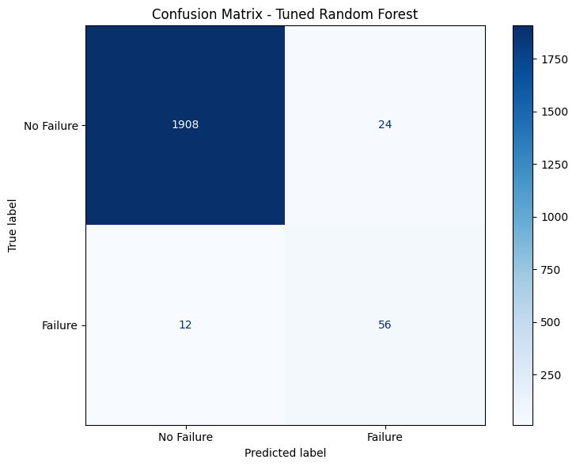
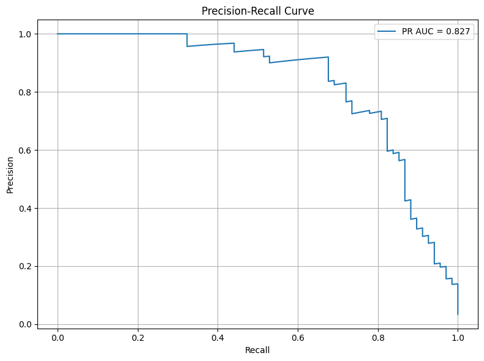
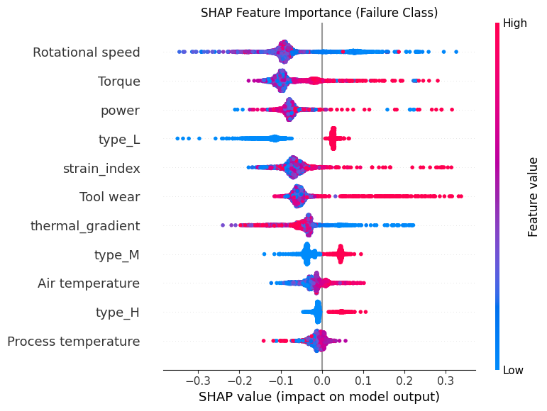

# Predict Machine Failures with ML

[](https://colab.research.google.com/github/manitousi123/Predict-Machine-Failures-with-ML/blob/main/Predict_Machine_Failures_with_ML.ipynb)

Predicting industrial machine failures from sensor readings so maintenance teams can step in before a breakdown.

## Problem
Unplanned downtime is expensive, and failures are rare enough that they are easy to miss. This project flags machines at risk of failure from process and sensor data. Recall matters most, because a missed failure costs far more than a false alarm.

## Data
[AI4I 2020 Predictive Maintenance dataset](https://archive.ics.uci.edu/dataset/601/ai4i+2020+predictive+maintenance+dataset) (UCI ID 601): 10,000 machine records with product type (L/M/H), air and process temperature, rotational speed, torque, and tool wear. Only **3.4% of records are failures** (339 of 10,000). A dummy classifier that always predicts "no failure" reaches 96.6% accuracy while catching nothing, so models are judged on recall, precision, and PR-AUC instead.

## Approach
1. **EDA**: Compared feature distributions by failure class and checked correlations between sensors.
2. **Feature Engineering**: Built three physics-inspired features:
   - `power` = torque × angular velocity
   - `thermal_gradient` = process temperature − air temperature
   - `strain_index` = tool wear × torque

   The categorical `Type` column was one-hot encoded.
3. **Class Imbalance**: Applied SMOTE to the **training set only** after a stratified 80/20 split, so the test set keeps the real 3.4% failure rate.
4. **Modeling**: Trained Logistic Regression, Random Forest, and Gradient Boosting inside a scaling pipeline. Tuned the Random Forest with `RandomizedSearchCV` (20 iterations, 5-fold stratified CV, recall scoring).
5. **Failure-mode extension**: Trained a multi-class Random Forest to predict *which* failure mode occurs (TWF, HDF, PWF, OSF).

## Results

Binary failure prediction on the held-out test set (2,000 samples, 68 failures):

| Model | Recall | Precision | F1 |
|---|---|---|---|
| Logistic Regression | 0.76 | 0.24 | 0.36 |
| Random Forest | 0.78 | 0.71 | 0.74 |
| Gradient Boosting | 0.87 | 0.51 | 0.64 |
| **Random Forest (tuned)** | **0.82** | **0.70** | **0.76** |

**Best model**: Tuned Random Forest. It catches 56 of 68 failures with 24 false alarms and has a **PR-AUC of 0.827**. Gradient Boosting has higher recall, but at much lower precision (about 57 false alarms). Gradient Boosting was not tuned, and a recall gap of 0.87 vs 0.82 is about 3 samples, so the comparison is preliminary.

<p align="center">
  
  
</p>

### Failure-mode prediction

| Failure Mode | Test Support | Precision | Recall | F1 |
|---|---|---|---|---|
| Heat Dissipation (HDF) | 23 | 0.91 | 0.91 | 0.91 |
| Power (PWF) | 18 | 0.94 | 0.94 | 0.94 |
| Overstrain (OSF) | 16 | 1.00 | 0.94 | 0.97 |
| Tool Wear (TWF) | 9 | 0.06 | 0.11 | 0.08 |

HDF, PWF, and OSF follow clear physical rules and are predicted well. Tool wear failure is close to random. It has the fewest examples and depends on a wear threshold that the features capture poorly. Random failures (RNF) were left out because they are random by design.

## Interpretability

Using SHAP values on the tuned Random Forest, the top 5 drivers of failure
(ranked by mean absolute SHAP value) are:

1. **Rotational speed** (low speed increases failure risk). This is the
   strongest single driver.
2. **Torque** (high torque increases failure risk). High load is a consistent
   failure signal.
3. **`power`** (engineered; extreme values increase risk). This captures the
   combined effect of speed and torque.
4. **Product type L** (increases risk). Low-quality products fail more often
   than M and H variants.
5. **`strain_index`** (engineered; high values increase risk). This combines
   tool wear and torque and matches overstrain behaviour.

Tool wear (6th) has the largest individual pushes toward failure once it is
high, and a low `thermal_gradient` (7th) pushes toward failure, which matches
the heat dissipation failure mode. The engineered features helped but did not
beat their raw inputs: rotational speed and torque still rank first and second.
These are associations learned by the model, not causal effects. Correlated
features (torque, `power`, `strain_index`) share credit.



*Each dot is one test sample. Position shows its push toward (right) or away
from (left) failure; colour shows the feature value. Because SMOTE balanced the
training data, model scores are not calibrated real-world failure
probabilities.*

## Limitations and Next Steps
- Tune Gradient Boosting with the same search and compare on cross-validated PR-AUC.
- Lower the decision threshold below 0.5 and measure the recall/precision trade-off.
- Run an ablation without the engineered features to measure what they add.
- Results come from a single train/test split and carry sampling noise.

## Project Structure
```
Predict_Machine_Failures_with_ML.ipynb   # Full pipeline: EDA, features, modeling, SHAP, failure modes
reports/figures/                         # Saved plots used in this README
requirements.txt                         # Python dependencies
```

## Reproduce
```bash
pip install -r requirements.txt
jupyter notebook Predict_Machine_Failures_with_ML.ipynb
```

Or open the notebook directly in Colab using the badge above. The dataset downloads automatically through `ucimlrepo`.
